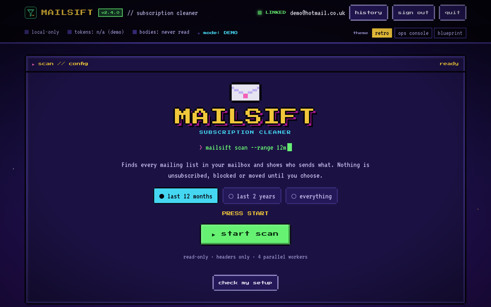
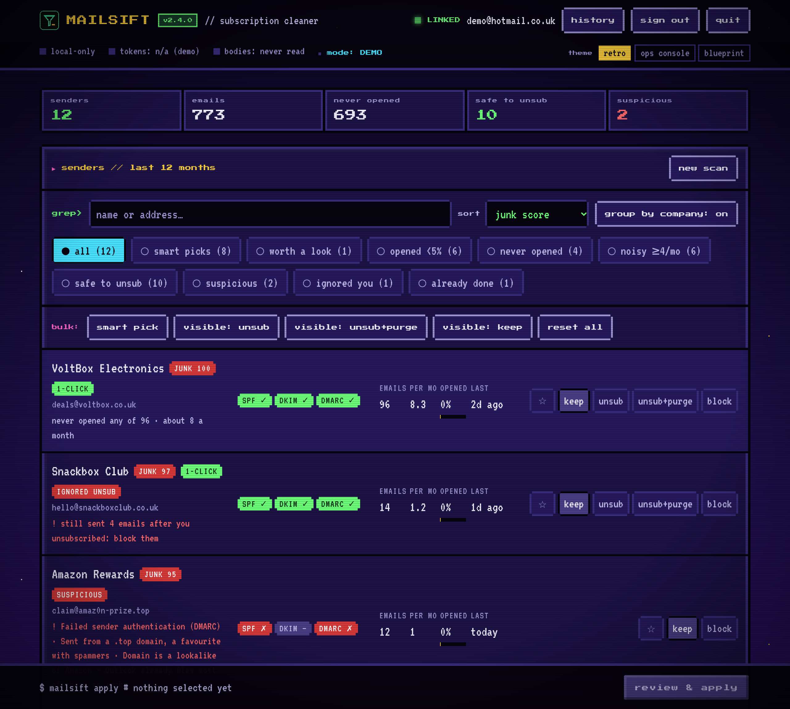
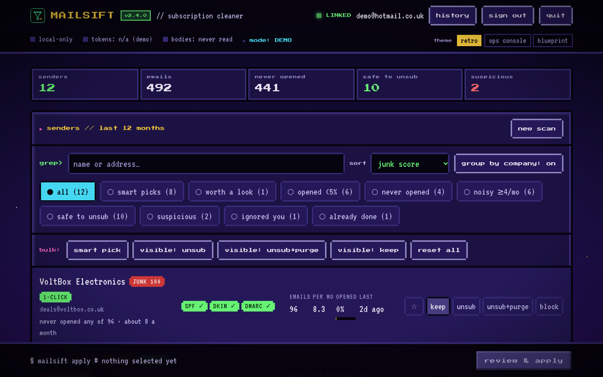
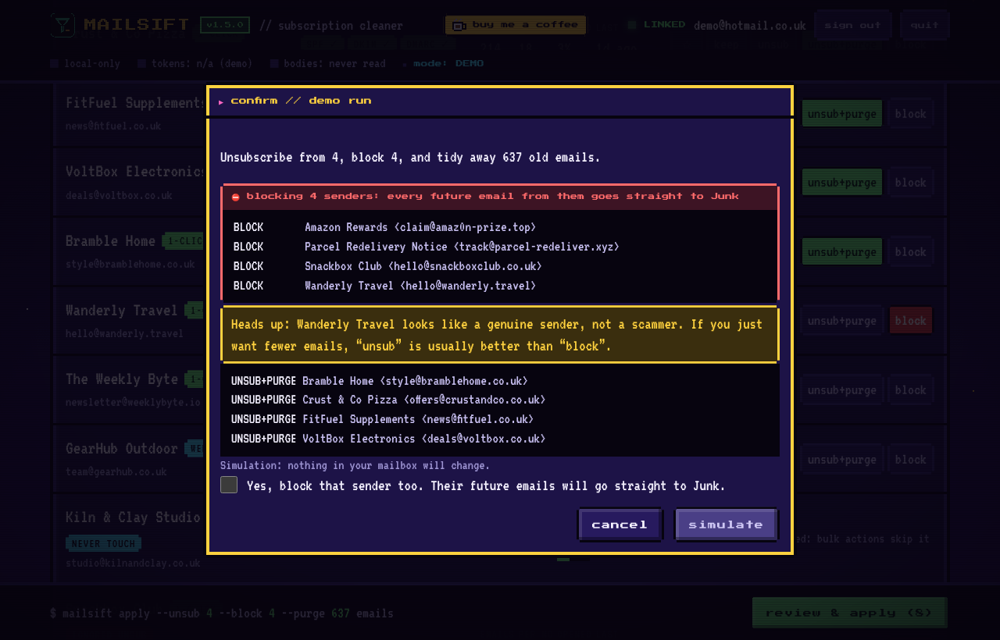
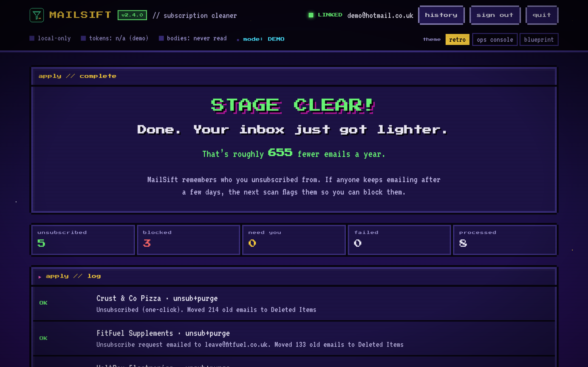

<div align="center">

# MAILSIFT

**Clear the newsletter and junk pile-up out of your Hotmail / Outlook.com in a couple of minutes, safely and privately.**

[](https://github.com/deanobaker3-alt/mailsift/actions/workflows/build.yml)
[](LICENSING.md)
[](#download)

**[⬇ Download the latest release](https://github.com/deanobaker3-alt/mailsift/releases/latest)**



</div>

## What it does

MailSift scans your mailbox, finds every mailing list, and shows you **who sends what, how often, and how much of it you actually read**. Then you choose, sender by sender or in bulk:

| | |
|---|---|
| **keep** | Leave them alone. |
| **unsub** | Unsubscribe properly (one-click, by email, or via their page). |
| **unsub+purge** | Unsubscribe *and* move their old emails to Deleted Items. |
| **block** | Send everything from them, now and in future, to Junk. |
| ☆ | **Never touch:** star your bank, school, etc., and MailSift leaves them alone. |

Then:

- **Smart pick** does the obvious ones for you. Every sender gets a junk score from 0 to 100, with the reasons shown next to it: how much of their mail you open, how much they send, whether you've stopped opening them lately, and how much Outlook already files as junk. It only selects the clear-cut ones (70+), marks the borderline ones "worth a look", and never touches anyone you've emailed yourself.
- **Senders from the same company are grouped**, so a brand with three mailing lists is one decision, not three. The total shows roughly how many emails a year your clean-up saves.
- **Suspicious senders can only be blocked, never unsubscribed.** Clicking "unsubscribe" on a scam just tells them your address is live. MailSift checks SPF, DKIM and DMARC, lookalike domains (`amaz0n…`) and brand impersonation, and shows you why.
- **Nothing is permanently deleted.** Mail goes to Deleted Items or Junk, and **undo** puts your last clean-up back.
- **It remembers who you unsubscribed from** and flags anyone who keeps emailing anyway.



## Private by design

- **It runs on your own PC.** Your emails go from Microsoft to your computer and nowhere else. There's no MailSift server and no tracking, and nobody, including the author, ever sees your mail.
- **It never sees your password.** You sign in on Microsoft's own page; MailSift only gets a token, stored encrypted by Windows.
- **Headers only.** It reads who an email is from and how it can be unsubscribed, never what's inside.
- **The code is open** so you don't have to take any of this on trust. **Forget me** wipes everything it saved.

## Download

1. Get **MailSift.exe** from the **[latest release](https://github.com/deanobaker3-alt/mailsift/releases/latest)**. Read `USER_GUIDE.txt` there too if you like.
2. Double-click it. Your browser opens on MailSift.
3. **Sign in with Microsoft**, then scan, choose and apply.

**You need:** Windows 10 or 11, and a **Hotmail, Outlook.com, Live or MSN** address. Gmail and work/school accounts aren't supported.

**Two warnings you'll see** (because it's a free hobby project, not a big-company app):
- **Windows SmartScreen**: "Windows protected your PC". Click **More info → Run anyway**.
- **Microsoft's consent screen** says the app is **unverified**. Check the permissions it asks for (below), then **Accept**.

<details>
<summary><b>The permissions it asks for, and why</b></summary>

| Permission | Why |
|---|---|
| `Mail.ReadWrite` | Read email headers; move old mail to Deleted Items or Junk |
| `Mail.Send` | Send an "unsubscribe" email when that's the only option a sender offers |
| `MailboxSettings.ReadWrite` | Create the "MailSift blocklist" inbox rule |
| `User.Read` | Show which account is signed in |

Remove access any time at **account.live.com/consent/Manage**.
</details>

### Verify your download

Only download from this repo's **Releases** page. To check your copy is genuine, run this in a command prompt:

```
certutil -hashfile MailSift.exe SHA256
```

The result should match `MailSift.exe.sha256` on the release. With the [GitHub CLI](https://cli.github.com/) you can also confirm it was built by this repo's workflow:

```
gh attestation verify MailSift.exe --repo deanobaker3-alt/mailsift
```

Each release also includes **`MailSift-sbom.json`**, a full parts list of everything bundled inside.

## Screenshots

| Scanning | Confirming | Done |
|---|---|---|
|  |  |  |

*Shown in demo mode with a pretend mailbox: try it yourself with `MailSift.exe --demo`.*

## FAQ

**Does it work on my phone?** Not directly; it's Windows-only for now. But everything it does happens inside Outlook.com, so once you've run it on a PC, your phone's mail app shows the cleaner inbox too.

**Can it delete my emails?** No. It only *moves* mail (to Deleted Items or Junk), and **undo** reverses your last clean-up. Unsubscribes can't be undone, because the request has already gone to the sender.

**Will it touch my personal emails?** No. It only looks at mailing-list mail (anything with an unsubscribe header). Emails from people never appear.

**Is it safe to try?** Run `MailSift.exe --dry-run` from a command prompt: it scans your real mailbox but changes nothing. Or `--demo` for a pretend mailbox.

## Security

The threat model and every control are in **[SECURITY.md](SECURITY.md)**. Found a problem? Please report it privately via the repo's **Security** tab rather than a public issue.

## Building it yourself

See **[docs/BUILDING.md](docs/BUILDING.md)**: registering your own Microsoft app, building the `.exe`, running the tests, and how releases work.

## Licence

**Free for personal and non-commercial use** under PolyForm Noncommercial 1.0.0. Selling it, bundling it into a product, or using it at work needs a **commercial licence**. See **[LICENSING.md](LICENSING.md)**. Contributions welcome: see [CONTRIBUTING.md](CONTRIBUTING.md).

## Support

MailSift is free. If it saved you some hassle, you can **[buy me a coffee](https://ko-fi.com/tlemon)**. ☕
